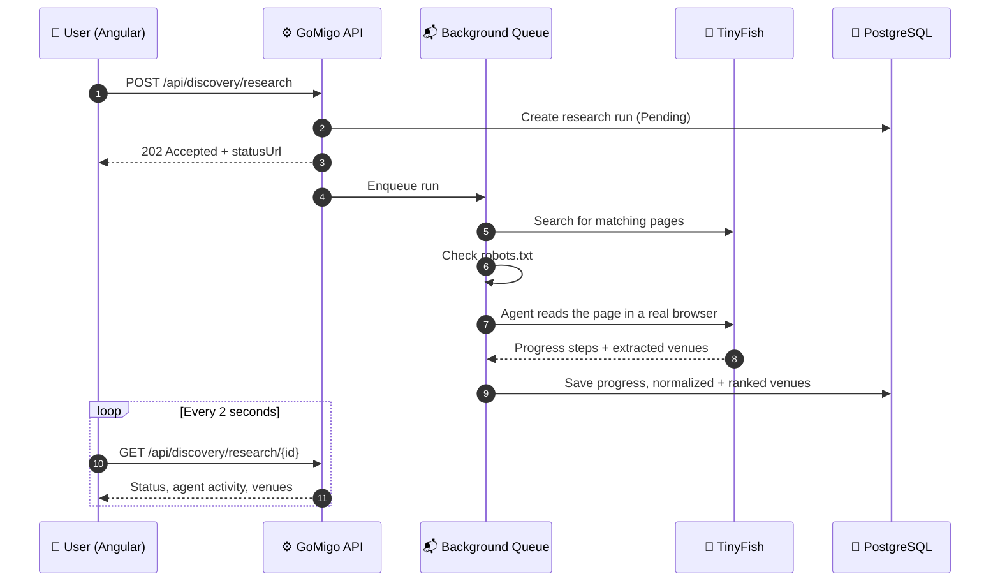

<div align="center">

# 🧭 GoMigo

### *Your next move, figured out.*

**Tell GoMigo where you are, how much time you have, what you want to spend and what you feel like doing.<br/>AI web agents research the live web in real time and bring back places that fit, with sources.**


🏆 *Built for the TinyFish Hackathon*

</div>

---

## 💡 The Problem

You have **two free hours** in Bengaluru, **₹500** in your pocket and you're in the mood for **something fun**. Search engines give you ten-year-old listicles, maps give you pins without context, and nobody tells you whether a place is open, affordable or worth the time you have.

## ✨ The Solution

GoMigo turns a short request into a **live web research run**:

1. 📍 **Where:** type a neighbourhood or share your location
2. ⏱️ **How long:** from 30 minutes up to a full day
3. 💰 **Budget:** per person, in INR
4. 🎭 **Mood:** Fun · Food · Culture · Outdoors · Nightlife · Shopping · Relaxation
5. 📝 **Anything else:** "kid-friendly", "indoors, it's raining", ...

GoMigo then sends **TinyFish AI web agents** to real web pages in a real browser. They pull out venues, and GoMigo ranks them against your constraints. You can **watch the agents work**, step by step and with screenshots, while the results come in.

---

## 🌟 Key Features

| | Feature | Description |
|---|---------|-------------|
| 🤖 | **Live AI web research** | TinyFish Search picks the most relevant pages, then a TinyFish agent reads them in a real browser |
| 👀 | **Watch the agents work** | Live activity feed with progress messages and per-step browser screenshots |
| 🎯 | **Smart ranking** | Venues are scored on budget, time, mood, evidence quality and distance |
| ✅ | **Honest verification** | Every venue is marked **Verified**, **Partially Verified** or **Unverified**, with its source link and an evidence excerpt |
| 🚫 | **No made-up data** | Opening hours, prices and visit times appear only if a source published them; anything unknown is shown as unknown, with a warning |
| 🗺️ | **Location aware** | Place autocomplete and reverse geocoding (OpenStreetMap / Photon), with Bengaluru neighbourhoods suggested first |
| 💡 | **Curated suggestions** | Instant suggestion cards for your area before you even start a search |
| 🔁 | **Resilient by design** | Partial results, timeouts and failures are handled gracefully, and you can retry with one click |
| 🤝 | **Respectful crawling** | `robots.txt` is checked before any agent visits a page |

---

## 🔄 How It Works



### 🎯 Ranking Model

| Signal | Weight | Notes |
|--------|:------:|-------|
| 💰 Budget fit | **35** | Unknown cost gets partial credit and a warning |
| 🎭 Mood / category | **25** | Exact matches are always kept ahead of other venues |
| ⏱️ Fits your time | **20** | Compares the suggested visit length with the time you have |
| ✅ Evidence quality | **15** | Verified > Partially Verified > Unverified |
| 📍 Proximity | **5** | Straight-line distance, used only when coordinates are known |

Duplicate venues are merged, and the most complete record is kept.

---

## 🏗️ Architecture

GoMigo follows **Clean Architecture**: business rules have no dependency on frameworks, databases or external APIs.

```
GoMiGo/
├── backend/                      # .NET 8 solution
│   ├── src/
│   │   ├── GoMigo.Domain/        # Entities & rules: DiscoveryRequest, VenueCandidate, ResearchRun
│   │   ├── GoMigo.Application/   # Use cases: discovery, normalization, ranking, ports
│   │   ├── GoMigo.Infrastructure/# TinyFish client, Postgres (Dapper), queue, background worker
│   │   └── GoMigo.Api/           # REST controllers, Swagger, global error handling
│   └── tests/
│       ├── GoMigo.UnitTests/
│       └── GoMigo.IntegrationTests/
├── frontend/gomigo-web/          # Angular 21 + Tailwind CSS 4
│   └── src/app/
│       ├── core/                 # API service, models, layout
│       └── features/discovery/   # Discover page, venue cards, agent activity feed
└── database/
    ├── migrations/               # Versioned SQL migrations
    ├── seeds/                    # Sample data
    └── migrate.ps1               # Forward-only migration runner
```

### 🔌 Pluggable Providers

You can switch providers in configuration alone, with no code changes:

| Setting | Options | Use |
|---------|---------|-----|
| `Persistence__Provider` | `Postgres` · `InMemory` | Use `InMemory` to run with no database |
| `Research__Provider` | `TinyFish` · `Mock` | Use `Mock` to run offline with no API key |
| `Research__Mock__Scenario` | `Success` · `Partial` · `Failure` · `Empty` | Demo any outcome on demand |

---

## 🧰 Tech Stack

| Layer | Technology |
|-------|-----------|
| **Frontend** | Angular 21 (standalone components, Signals), RxJS, Tailwind CSS 4, TypeScript 5.9 |
| **Backend** | ASP.NET Core 8 Web API, C# 12, `BackgroundService` + channel-based queue, Swagger / OpenAPI |
| **Data** | PostgreSQL, Dapper, Npgsql, SQL migrations |
| **AI / Web** | TinyFish Web Agent API, TinyFish Search API |
| **Geo** | Photon (OpenStreetMap) autocomplete & reverse geocoding |
| **Testing** | xUnit, `WebApplicationFactory` integration tests, Coverlet |

---

## 🚀 Getting Started

### Prerequisites

- [.NET 8 SDK](https://dotnet.microsoft.com/download)
- [Node.js](https://nodejs.org/) 20+ and npm
- *(Optional)* PostgreSQL 14+ and a [TinyFish API key](https://agent.tinyfish.ai/api-keys)

### ⚡ Quick start (no database, no API key)

```bash
cd backend
```

```bash
dotnet run --project src/GoMigo.Api --launch-profile http
```

> Set `Persistence__Provider=InMemory` and `Research__Provider=Mock` as environment variables first. The API runs at **http://localhost:5080**, with Swagger at `/swagger`.

In a second terminal:

```bash
cd frontend/gomigo-web
```

```bash
npm install
```

```bash
npm start
```

Then open **http://localhost:4200** 🎉

### 🤖 Running with live TinyFish agents

1. Copy the variables from [`.env.example`](.env.example) and set them as environment variables (or use `dotnet user-secrets`):
   - `Research__Provider=TinyFish`
   - `TINYFISH_API_KEY=<your key>`
2. *(Optional)* For PostgreSQL, set `Persistence__Provider=Postgres` and `ConnectionStrings__GoMigo`, then apply the migrations:

```powershell
$env:PGPASSWORD = '<your password>'; .\database\migrate.ps1 -CreateDatabase
```

> 🔐 The TinyFish API key stays on the backend. Agent screenshots are sent through the API, so the key never reaches the browser.

### 🧪 Running tests

```bash
dotnet test backend/GoMigo.sln
```

---

## 📡 API Overview

| Method | Endpoint | Description |
|--------|----------|-------------|
| `GET` | `/api/discovery/options` | Categories, presets and limits for the form |
| `GET` | `/api/discovery/curations` | Instant suggestion cards for an area |
| `POST` | `/api/discovery/research` | Start a research run → `202 Accepted` |
| `GET` | `/api/discovery/research/{runId}` | Status, progress events and ranked venues |
| `POST` | `/api/discovery/research/{runId}/retry` | Re-queue a failed or partial run |
| `GET` | `/api/discovery/research/{runId}/agents/{agentRunId}/steps/{stepId}/screenshot` | Screenshot of an agent step, sent through the API |
| `GET` | `/api/places/autocomplete` | Type-ahead location suggestions |
| `GET` | `/api/places/reverse` | Coordinates → place name |

Full interactive docs are at **`/swagger`** while the API is running.

---

## 🛣️ Roadmap

- 🗓️ Multi-stop **itineraries** that chain venues into one outing
- 🌆 More cities beyond Bengaluru
- 💱 Multi-currency budgets
- 📲 Shareable plans

---

<div align="center">

Made with ☕ and 🤖 for the **TinyFish Hackathon**

⭐ *If you like GoMigo, give it a star!* ⭐

</div>
